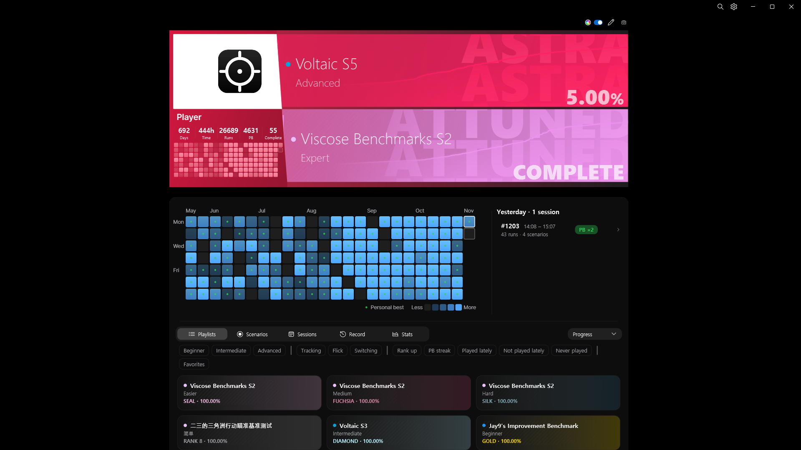
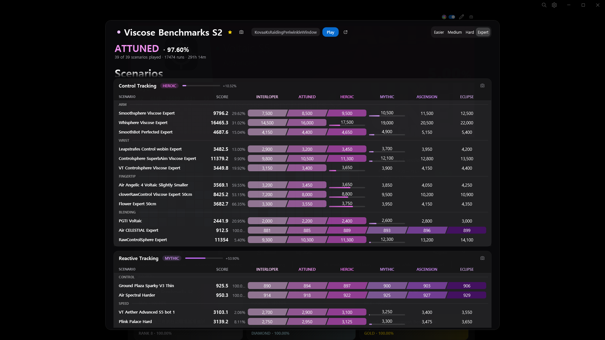
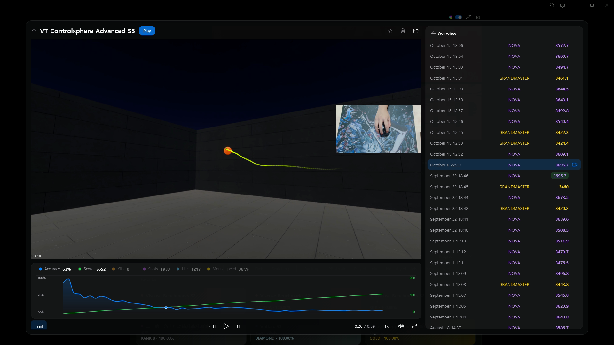
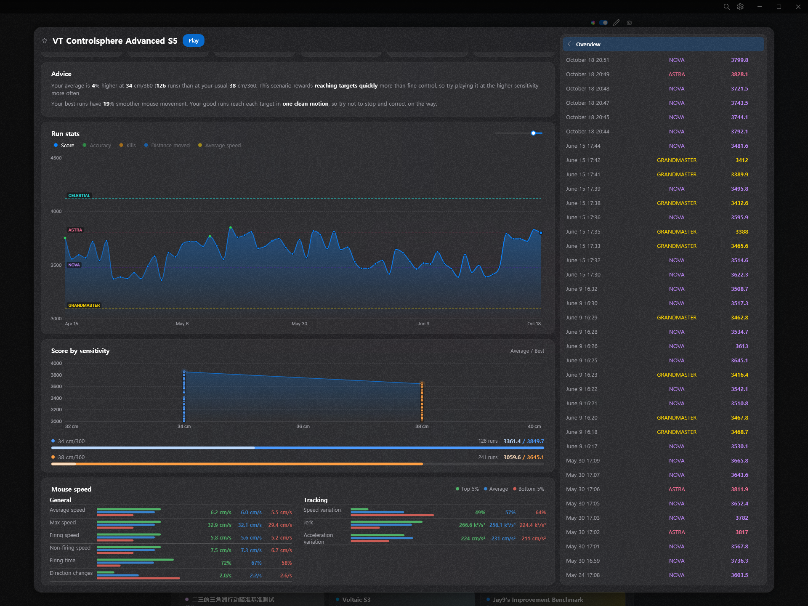
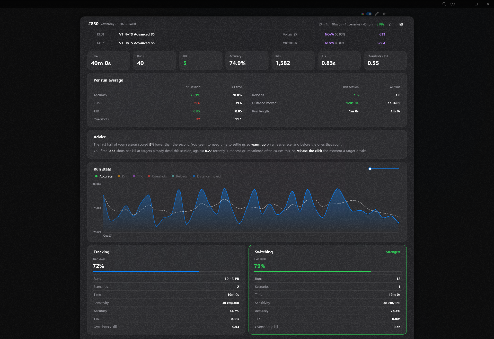
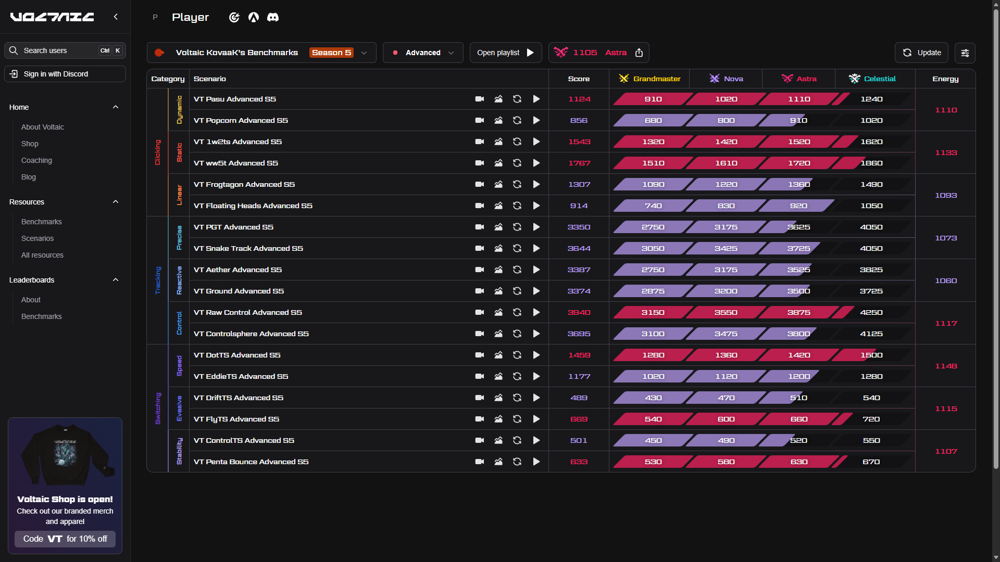
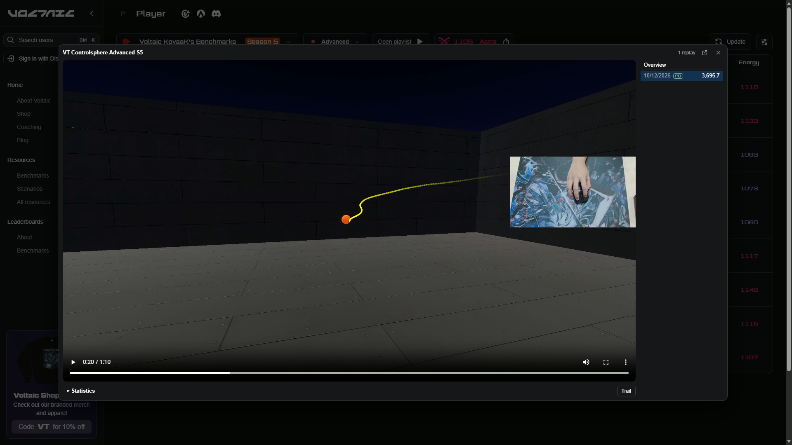

# KovaaK's Companion

Watch your KovaaK's benchmark progress grow, and watch every run back.

KovaaK's Companion is a Windows tray app. It reads your KovaaK's stats and benchmark progress into one page, records each run while you play, and replays it with your crosshair path drawn on top of the video.

## Overview

- **Stats:** every benchmark playlist with its tier and progress, your favorites, a calendar of the days you played, and your sessions.
- **Replays:** each run is saved as a video clip together with your mouse path, so you can see where the aim went, not only the score.
- **Quiet:** it lives in the tray, starts there when Windows or KovaaK's starts it, and only records while the game is running.

**Install:** download the exe from [Releases](https://github.com/dededed1024/KovaaksCompanion/releases) and run it. There is no installer. Settings and the run archive are stored under `%LOCALAPPDATA%\KovaaksCompanion`. Videos go to a `KovaaksCompanion` folder at the root of the drive KovaaK's is installed on, unless you change that location in Settings.

## Key features

- **Benchmark tiers:** 132 benchmark playlists, from Voltaic and Revosect to Viscose, with each scenario scored against every tier threshold. Hover a scenario to see how many points it needs for the next tier, or copy the playlist's sharecode.
- **Server scores count:** Your best score and last runs of each scenario are fetched from KovaaK's servers and kept, so runs from another PC or from before you installed the app count toward your tiers and stats.
- **Automatic recording:** Recording starts when KovaaK's opens, and each run is saved as its own clip, Low to Ultra quality at 30 to 1000 FPS. Up to three webcams go into the game video or into separate files.
- **Replay with mouse trail:** Your crosshair path is drawn over the video: green for hits, red for misses, red to green by accuracy while you hold fire. Step in 1/60 s, change the speed, or overlay your previous run on the chart.
- **Mouse stats:** Every recorded run gets figures such as reaction time, path efficiency, overshots per kill and click delay after stop, compared with your top and bottom 5% of runs. Score by sensitivity shows which cm/360 suits each scenario.
- **Advice:** Short tips for each scenario and each session, measured only against your own runs: when to warm up, when a slump means stopping for the day, or which sensitivity scores higher.
- **Sessions and tier-ups:** When KovaaK's closes, the card for that sitting opens. A run that lifts a playlist or scenario to a new tier, or completes it, puts a card with confetti on Home. Session and profile cards copy as images.
- **Storage limits:** Cap the video folder by size or age, keep only each session's best run, or save video for PBs only. PB replays can be kept safe, and a deleted video keeps its stats and mouse path.
- **Browser player:** A userscript adds a video icon next to your recorded scenarios on evxl.app and app.voltaic.gg and plays the clip with its trail in a popup, even when the app is not running (Chrome or Edge).

## FAQ

**Is my data safe?**
Your replays, videos and stats stay on your PC. The app asks KovaaK's public web API for your scores, using your Steam ID and KovaaK's username, and asks GitHub for new versions. It has no telemetry and sends nothing else.

**Is it anti-cheat safe?**
It never hooks into, injects into or reads the memory of the game, and it does not modify game files. Video uses Windows' standard window capture and the game's audio, and the mouse path comes from Windows Raw Input. It is an unofficial tool, so KovaaK Games has not reviewed it.

**What PC do I need?**
Recommended (an estimate, not benchmarked): CPU i3-12100F / Ryzen 5 3600, GPU GTX 750 Ti / Radeon RX 560 or better, with current graphics drivers. Windows 10 2004 or newer, x64, and KovaaK's installed through Steam; the app finds the install and the stats folder on its own. Video needs a GPU with a hardware H.264 encoder (NVIDIA NVENC, AMD AMF or Intel Quick Sync). There is no software encoding; without a supported GPU the stats features still work and recording stays off.

## App tour

Everything lives in one window. Pages open as popups over it, so you never lose your place.

### Home

Your profile card with the playlists you pinned, the activity calendar with your latest session, and tabs for Playlists, Scenarios, Sessions, Record and Stats underneath.

  

### Playlist

Open a playlist to see every scenario's score against each tier threshold, grouped by category with a progress bar to the next tier.

  

### Replay

Every recorded run plays back with your mouse path drawn over the video. The hand cam is composited into the clip, and a chart of accuracy and score sits under it.

  

### Scenario overview

Best score, runs, accuracy and the score history with the tier lines, mouse speed against your top and bottom 5% of runs, and every run of the scenario on the right.

  

### Session

Everything you played in one sitting, with advice, accuracy over the session and your tier level in tracking, flick and switching.

  

### Browser icons

A userscript puts a video icon next to every scenario you have a recording of on supported benchmark sites, such as the Voltaic app.

  

Click the icon to play the clip in a popup over the page, with the mouse trail on top.

  

## License

The app is licensed under the GNU General Public License v2 or later ([LICENSE](LICENSE)); releases up to 1.4.3 were MIT licensed.

Unofficial; not affiliated with or endorsed by KovaaK Games. "KovaaK's" and its branding belong to KovaaK Games. Benchmark playlist definitions come from [evxl.app](https://evxl.app) by EviL. Video uses libobs from an unmodified OBS Studio build (GPL v2 or later); see [THIRD-PARTY-NOTICES.md](THIRD-PARTY-NOTICES.md) for sources and licenses.

To build it yourself, run `dotnet build KovaaksCompanion.slnx -c Release`. The build downloads a pinned, hash-checked OBS Studio release (`scripts/fetch-libobs.ps1`) and embeds the parts libobs needs in the exe. See [CONTRIBUTING.md](CONTRIBUTING.md) and the module map in [docs/wiki/structure.md](docs/wiki/structure.md).
